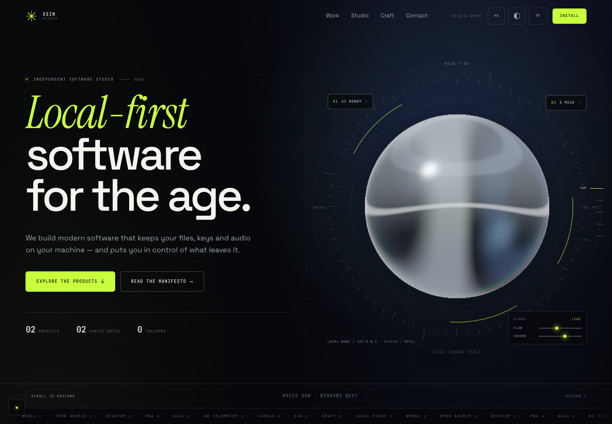
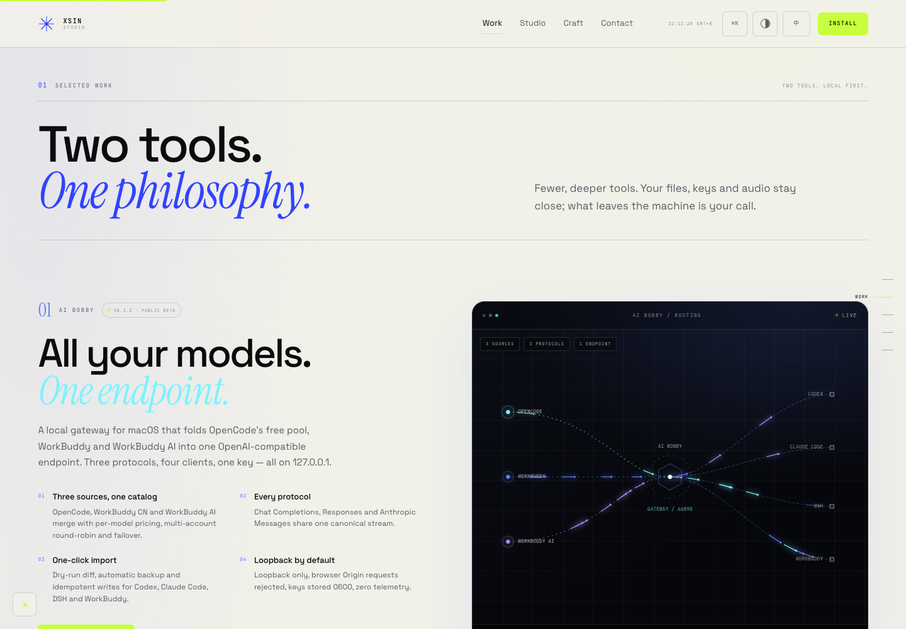
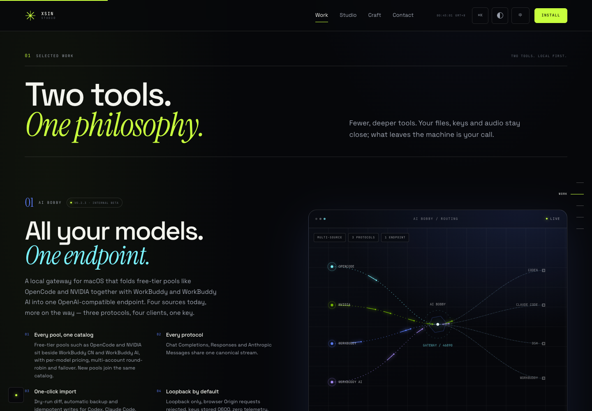
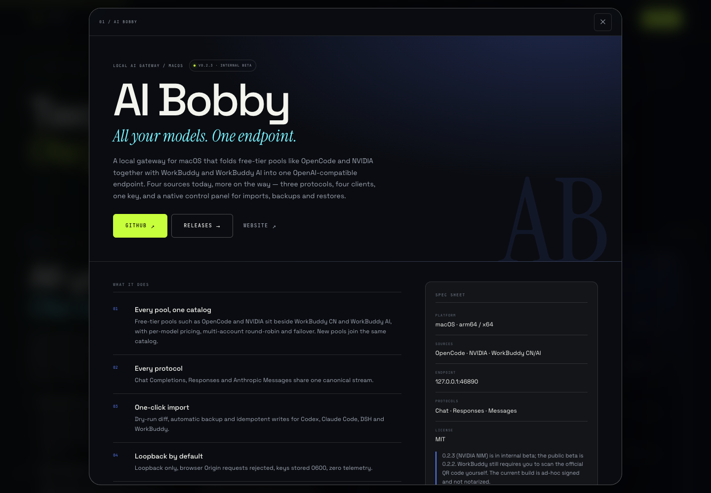
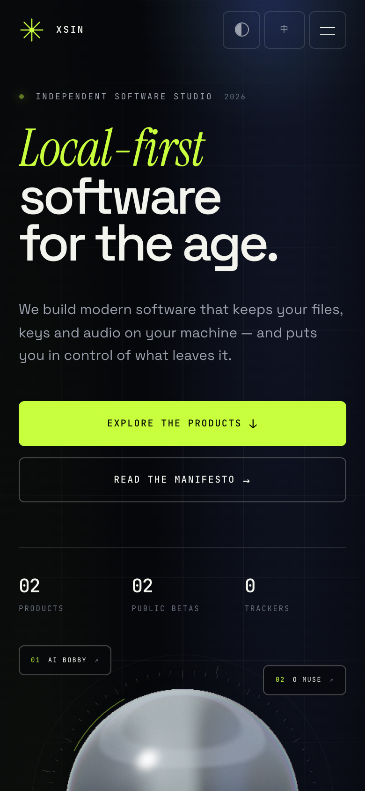
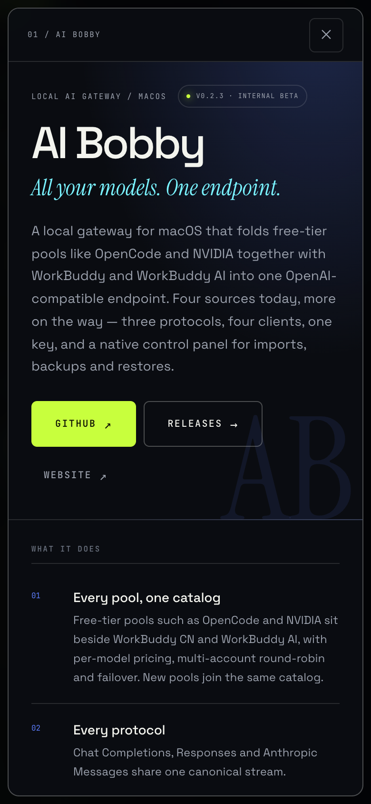

# XSin Studio — interactive design draft

A complete, dependency-free clickable prototype for the XSin Studio product
showcase PWA. It is the design source for the production app; it is not the app.

## Run

From the repository root:

```bash
python3 -m http.server 4173 --bind 127.0.0.1 -d prototype/xsin-studio
```

Open <http://127.0.0.1:4173/>. Serving over HTTP (rather than `file://`) enables
the service worker and the install prompt.

## Screens

| | |
|---|---|
|  |  |
|  |  |
|  |  |

## What to try

- **Hero** — drag the two sliders under the chrome orb (FLOW / CHROME), move the
  pointer, scroll.
- **AI Bobby** — hover the routing diagram; the four pools (OpenCode, NVIDIA,
  WorkBuddy CN/AI) and the client labels highlight their routes. Click the panel
  or “Open dossier”.
- **O Muse** — press play. The four stems are synthesised locally with Web Audio
  (no audio files). Mute and solo the lanes; the waveforms are live analysers.
- **Command palette** — `⌘K` / `Ctrl+K`, then filter and press Enter.
- **Ambient sound** — the top-bar toggle (also in the mobile menu). The page is
  silent until your first click; then a slow D-minor bed fades in. The toggle
  stops it for this page view only — nothing is stored. Design notes:
  [`docs/sound.md`](../../docs/sound.md).
- **Product dossiers** — deep-linkable at `#/work/ai-bobby` and `#/work/o-muse`.
- **Design controls** — bottom-left dock: grid, motion, custom cursor, theme.
  Keyboard: `G` grid, `M` motion, `C` cursor, `T` theme, `L` language.
- **Language** — 中文 / English, persisted to `localStorage`.
- **PWA** — install button (when the browser exposes `beforeinstallprompt`) or
  the in-page install sheet. The service worker caches the shell for offline use.

## Design decisions

- **Direction**: “precision tools / editorial lab”. Near-black paper, one
  acid-lime studio accent, chrome + product-owned palettes (AI Bobby blue/cyan,
  O Muse teal/violet). Product panels stay dark in both themes, like screens.
- **Type**: Space Grotesk (UI), Instrument Serif (display italics), JetBrains Mono
  (labels, data). Chinese falls back to PingFang SC / Songti SC.
- **Grid**: 4px base, 8px rhythm; 12-column overlay available from the dock.
- **Semantic tokens** only (`--bg`, `--ink`, `--line`, `--accent`, `--pc`), no
  hard-coded colors in components except brand content tokens.
- **Buttons**: three variants (`primary`, `outline`, `ghost`) and one small size;
  no call-site color/size overrides.
- **Motion**: short and reversible; GLSL, Canvas 2D and SVG each do one job.
  `prefers-reduced-motion` freezes every loop and skips the preloader. If WebGL
  is unavailable the hero falls back to a CSS chrome orb; without JavaScript the
  preloader and reveal states are disabled so the page still reads.
- **Sound**: one optional ambient bed (“Deep Field”), synthesised with Web Audio
  and never loaded as a file: a D-minor drone, open-fifth pads that change every
  9.6 s, filtered air and sparse bells, looping every 38.4 s. It starts only on
  the first real gesture, fades in over 3.2 s, suspends in background tabs, and
  is never remembered — a manual mute lasts for the page view. The control is an
  equaliser glyph with `aria-pressed`, not a speaker with a tooltip.
- **Footer legal**: the ICP filing (`粤ICP备2021128240号-5`, linked to
  `beian.miit.gov.cn`) and the studio address sit in the legal line, set in
  sans 10px so they read as information rather than as another mono label.
- **Data**: product facts are taken from the local READMEs of
  `xsin/ai-bobby` (0.2.2 public beta; 0.2.3 internal beta adds NVIDIA NIM) and
  `xsin/o-muse` (0.2.2 public beta, 0.3.0 preview). The production build will
  collect these at build time and normalise them into a typed data module.

## Files

```
index.html            structure + all CSS
sfx.js                the in-house Web Audio kit (oscillators, noise, reverb, envelopes)
ambient.js            "Deep Field": the ambient bed composed from sfx.js
app.js                i18n, WebGL shaders, Canvas, the stem synth, dialogs, PWA UI
COPY.md               reviewed copy deck: brand lines vs product facts
manifest.webmanifest  installable shell
sw.js                 network-first service worker
icons/                generated app icons
fonts/                self-hosted latin woff2 subsets
screens/              reference captures for this README
```

## Not production

This is throwaway prototype code: one file of imperative DOM, no tests, no
framework. The validated direction moves into the pnpm monorepo
(React 19 + Vite 8 + TypeScript 7 + Tailwind CSS 4 + shadcn/ui), following
[`docs/spec-ui.md`](../../docs/spec-ui.md).
